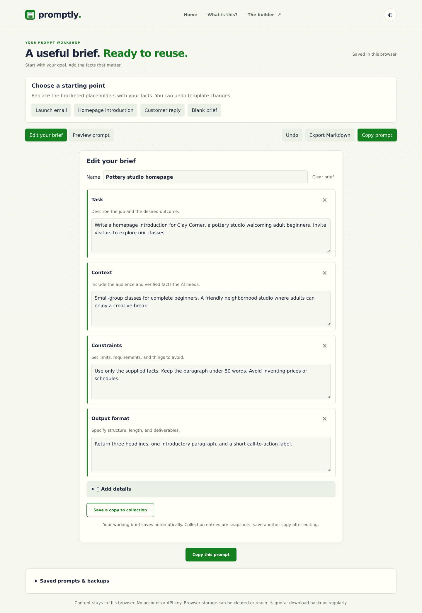
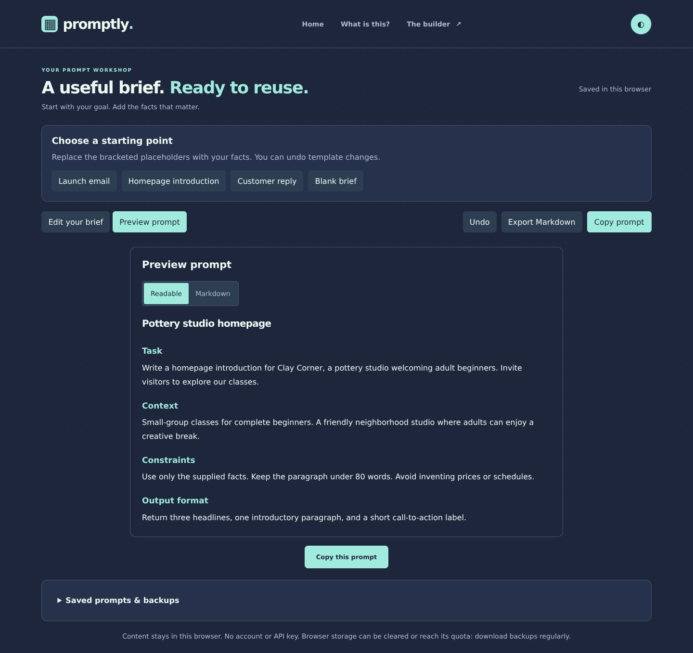

<div align="center">

# ▦ promptly.

### Your judgment. A clearer brief.

Turn repeat writing tasks into prompts you can actually reuse.<br>
A browser-local workshop for launch emails, homepage introductions, and customer replies.

[](https://promptly.thehawk6353.workers.dev/#builder)

**Start with the [live builder ↗](https://promptly.thehawk6353.workers.dev/#builder).**<br>
No account. No API key. Your intent stays yours.


</div>

## 🧩 Build a brief. Keep the useful parts.

1. **Choose a starting point.** Launch email, Homepage introduction, Customer reply—or a blank brief.
2. **Add your facts.** Define the task, audience, boundaries, and output. Replace template placeholders with verified information.
3. **Review and export.** Switch to the prompt preview, then copy or download Markdown for your preferred AI.
4. **Save it for next time.** Capture a named copy in your collection and open it later as a new working brief.



## ✦ Less starting over. More building on what works.

- **Focused templates** for common customer-facing writing tasks.
- **Eight block types**, with optional details for tone, examples, success criteria, and role.
- **A reusable collection:** open, rename, duplicate, archive, and restore saved prompts.
- **Undo** for block removal, clearing, and brief replacement.
- **JSON backup and import** to preserve editable briefs and collections.
- **Daylight and midnight palettes**, responsive controls, and reduced-motion support.

<details>
<summary><strong>🌙 See the prompt preview in midnight</strong></summary>



</details>

### 💾 Keep a copy of your work

Working edits save locally; collection entries are snapshots. Save another collection copy after making changes you want to reuse. Browser storage doesn't sync between devices and can be cleared—download JSON backups regularly. Markdown exports preserve prompt text; JSON backups preserve editable blocks and saved entries.

Promptly doesn't call an AI model or generate responses. It helps you organize the instructions you take to one.

## ⚙️ Under the hood

**HTML, CSS, and vanilla JavaScript.** No build step or runtime dependencies. `core.js` handles templates, collections, Undo, backups, and Markdown; `persistence.js` handles browser storage and conflicting edits across tabs; `app.js` connects the interface. The deployable files live in `dist/`.

Local saving needs browser storage and Web Locks over HTTPS or localhost. If storage is unavailable, you can still edit in memory and export your work. Recovery and development details: **[DEVELOPMENT.md](DEVELOPMENT.md)**.

## 💻 Run locally

With Git and **Node.js 18+** installed:

```sh
git clone https://github.com/Matthew-Hawk/Promptly.git
cd Promptly
npm start
```

Open **[http://127.0.0.1:5173/#builder](http://127.0.0.1:5173/#builder)**. No dependency installation needed; press **Ctrl+C** to stop. Use the local server rather than opening the HTML directly—the app uses JavaScript modules.

---

<div align="center">

**A little clarity changes everything. ✦**

[Build your brief ↗](https://promptly.thehawk6353.workers.dev/#builder) · [Matthew Hawkins](https://github.com/Matthew-Hawk)

</div>
