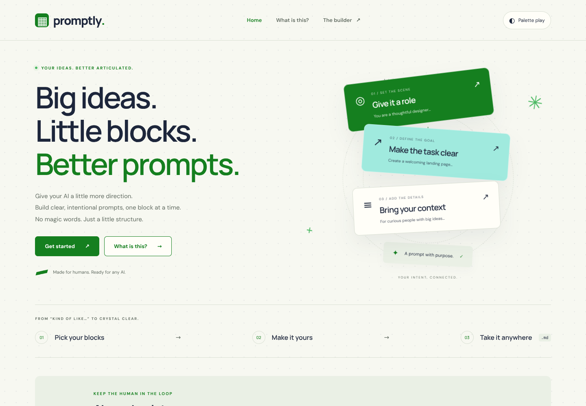
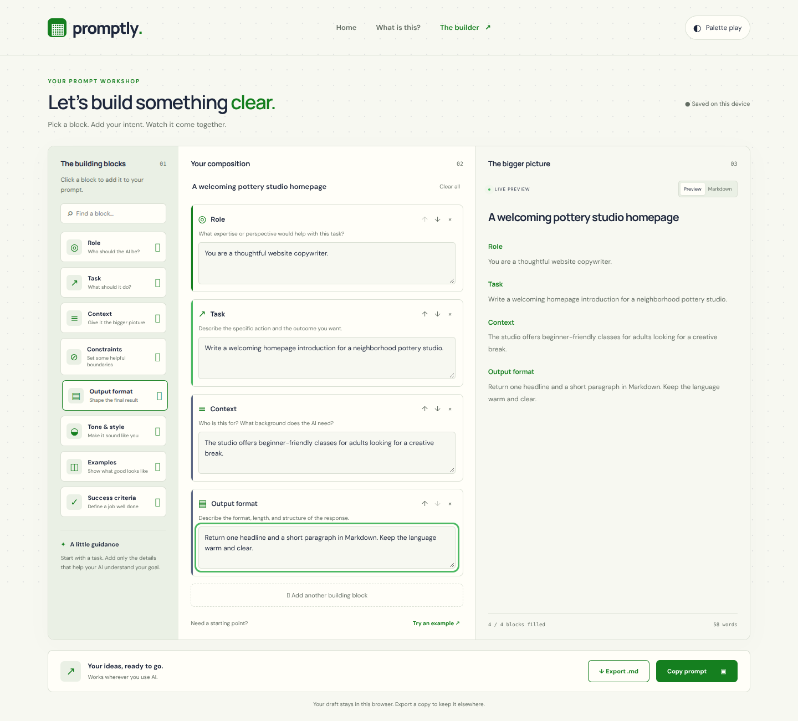
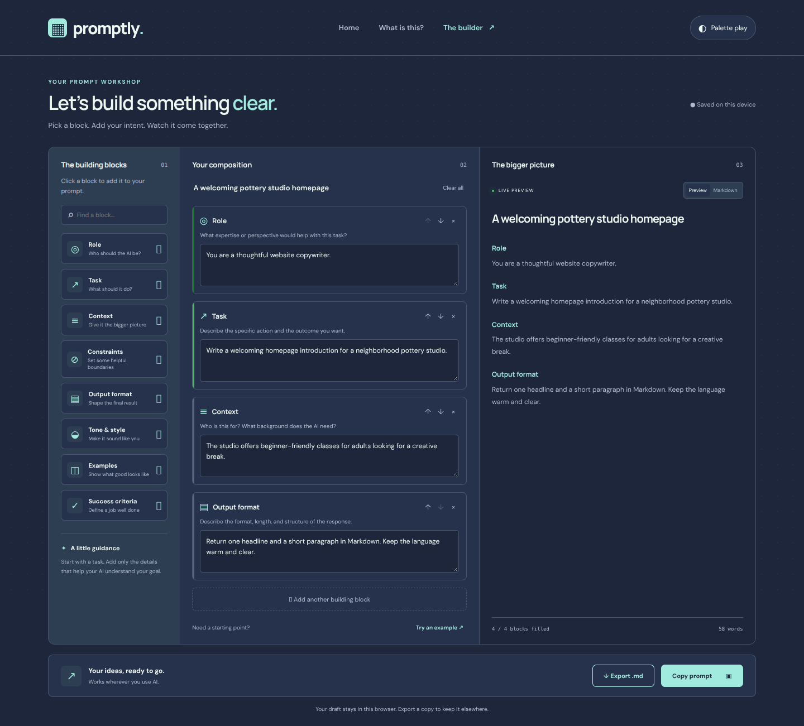

<div align="center">

# ▦ promptly.

### Big ideas. Little blocks. Better prompts.

Give your AI a little more direction.<br>
A visual workshop for turning your ideas into clear, intentional Markdown prompts.

[](https://promptly.thehawk6353.workers.dev/#builder)

**The best way to try Promptly is the [live builder ↗](https://promptly.thehawk6353.workers.dev/#builder).**<br>
No account. No API key. Just your ideas and a little structure.




</div>

## 🧩 Your intent, one block at a time.

1. **Pick your blocks.** Start with a task, then add the role, context, and details that matter.
2. **Make it yours.** Fill in the guided fields, give your prompt a name, and reorder or remove blocks as you go.
3. **See the bigger picture.** Switch between a readable preview and the generated Markdown.
4. **Take it anywhere.** Copy your prompt or export a `.md` file to use with your preferred AI.

**Eight building blocks:** Role · Task · Context · Constraints · Output format · Tone & style · Examples · Success criteria.



## ✦ A little clarity goes a long way.

- **Live preview** with filled-block and word counts.
- **Searchable block library** and an example prompt to get you started.
- **Daylight and midnight palettes**, plus subtle animation and reduced-motion support.
- **Browser-local draft saving**, including your prompt name, blocks, and palette preference.
- **Markdown export** for a portable copy you can keep elsewhere.

Promptly organizes your instructions; it doesn't send them to an AI model or generate AI responses. Drafts stay in this browser and aren't synced between devices. Export a copy you want to keep.

<details>
<summary><strong>🌙 See the midnight palette</strong></summary>



</details>

## ⚙️ Under the hood

**HTML, CSS, and vanilla JavaScript.** No build step, runtime libraries, or AI backend. Hash navigation connects the home, explanation, and builder views; `localStorage` keeps drafts and palette preferences. Google Fonts are optional, with local font fallbacks.

| File | Purpose |
| :--- | :--- |
| `dist/index.html` | Page layouts and builder interface |
| `dist/style.css` | Responsive design, palettes, and motion |
| `dist/app.js` | Blocks, previews, draft saving, and exports |
| `serve.cjs` | Local static server |

## 💻 Run locally

With Git and Node.js installed:

```sh
git clone https://github.com/Matthew-Hawk/Promptly.git
cd Promptly
node serve.cjs
```

Open **[http://127.0.0.1:5173/#builder](http://127.0.0.1:5173/#builder)**. No dependency installation needed. Press **Ctrl+C** to stop the server. You can also download and extract the repo ZIP, then run the same server command from its folder.

To host a copy, publish the contents of `dist/`. Clipboard access works best over HTTPS or localhost, subject to browser permissions.

---

<div align="center">

**Made for humans. Ready for your AI. ✦**

[Build your intent ↗](https://promptly.thehawk6353.workers.dev/#builder) · [Matthew Hawkins](https://github.com/Matthew-Hawk)

</div>
